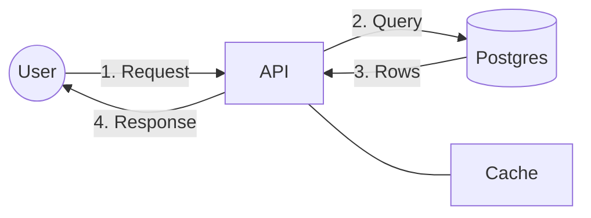

# Interactive Architecture Diagram Visualizer

An interactive visualization tool for exploring and understanding system architecture diagrams through dynamic sequences and component interactions.

## Overview

This project provides an interactive way to visualize and explore system architecture diagrams. It uses p5.js for rendering and allows users to step through system interactions, making it an excellent tool for understanding complex system designs and architectural patterns.

## Features

- Interactive sequence visualization
- Step-by-step walkthrough of system interactions
- Multiple sequence navigation
- Message schema visualization
- Component interaction exploration
- PlantUML parsing support
- Visual feedback system

## Mermaid Flow Animator (`/flow`)

`flow/index.html` is a standalone web viewer that takes a Mermaid flowchart and plays it as an animated flow. Numbered edge labels become steps that draw in one at a time, while unnumbered edges stay visible as the static architecture.



- Label prefixes `1.`, `2)`, `3:`, `1.2` and `2a.` all work; edges that share a number play in parallel.
- `%% <n>: text` comments add narration for step `n`.
- Controls: play/pause, step forward/back, jump to any step, speed, loop. Keys: <kbd>Space</kbd>, <kbd>←</kbd>/<kbd>→</kbd>, <kbd>Home</kbd>, <kbd>F</kbd> (hide editor).
- **Copy link** puts the source and details in the URL hash so a diagram can be shared.
- Click any box or arrow for a read-only popup. Arrows show the endpoint, method, headers, request and response; boxes show their type, its configured parameters, deployment details and connections. The details are written in YAML or JSON in the editor's **Details** tab:

  ```yaml
  types:                 # optional: extend or override the built-in types
    service: { fields: [language, owner, { key: slo, label: SLO target }] }
  nodes:
    API:
      type: service      # client, service, gateway, worker, database, cache, queue, external, or your own
      language: Go       # any other key is a parameter
      deploy: { platform: ECS, region: eu-west-1, replicas: 3 }
  edges:
    "2":                 # a step number, or "From->To" when two arrows share a number
      method: POST
      endpoint: /orders
      headers: { Authorization: Bearer <token> }
      request: { body: { cartId: string } }
      response: { status: 201 }
  ```
- **Version history.** Commit the diagram and details together with a message, roll back and forward between versions, or pick any version from the dropdown in the version bar or the **History** tab, which shows what each commit changed. History never loses a version: committing from an older version adds a new one at the end. Moving away from uncommitted changes asks first. Versions are kept in the browser's local storage.
- **Tool box.** A paint-style tool box beside the diagram inserts objects from the block library: boxes (service, database, cache, queue, worker, gateway, client, external, plus your own) open a short form; the API-call tool picks a source box, then a target box. Inserted objects are written into both the diagram and the details with `locked: true`, and are immutable for now: popups mark them Locked, and commits (and the assistant) may not change them.
- **Assistant.** The Assistant button opens a chat that edits the diagram and details for you. Claude proposes a complete new version through an `apply_changes` tool; the page checks that the Mermaid parses, the details parse and no locked object changed, and sends any problem back for Claude to fix. Accepted changes arrive as uncommitted edits. On the website it calls the Claude API from the browser with your API key (default model Claude Opus 5.5); inside a claude.ai artifact it uses the viewer's own Claude account instead.
- **Admin** (`#admin`): the Claude API key, model and effort, and the block library editor (add, edit, delete blocks and their parameters, shape, icon and badge colour; reset to the built-in set). Saved in this browser's local storage; the API key is sent only to api.anthropic.com.
- Uses Mermaid's own layout, so subgraphs, shapes and `classDef` styling carry over. Only `flowchart`/`graph` diagrams animate; other diagram types render as a still.

### Developing

The app is TypeScript in `flow/src`, bundled by esbuild into `flow/dist/app.js` (not committed).

```sh
npm install
npm run build          # flow/dist/app.js, then open flow/index.html
npm run dev            # rebuild on change
npm run typecheck
npm test               # unit tests (vitest)
npm run test:e2e       # browser smoke test; needs Playwright + Chromium, run after build and build:artifact
npm run build:artifact # flow/dist/artifact.html, a single self-contained page
npm run build:site     # _site/, what Netlify publishes
```

Code layout, as a pipeline from source text to the screen:

| Module | Role |
| --- | --- |
| `types.ts` | Shared contracts: `Adapter`, `Scene`, `StepGroup`, `EdgeRef`, `Effect` |
| `parse/steps.ts` | Pure text helpers: step numbers, sort order, narration, Mermaid escaping |
| `adapters/` | Turn source text into a rendered diagram and a `Scene`. `mermaid.ts` is the only file that touches Mermaid. Add formats with `registerAdapter` |
| `scene/bind.ts` | Renderer-independent binding: label matching, arrowhead recolouring, step grouping |
| `play/timeline.ts` | Playback state machine with no DOM; emits `load`, `cursor` and `playing` events |
| `play/effects.ts` | Edge states and the effects that bring a step on screen. Add effects with `registerEffect` |
| `details/schema.ts` | Parses and validates the Details document; built-in node types; edge lookup |
| `history/` | Version control with no page access: `repository.ts` (commits, checkout, back/forward), `diff.ts` (line change counts), `storage.ts` (local storage) |
| `lib/emitter.ts` | Typed event emitter shared by the timeline and the repository |
| `blocks/` | The block library (`library.ts`), inserting blocks into both texts (`insert.ts`), locked-object checks (`locks.ts`), storage |
| `ai/` | The assistant: instructions and the `apply_changes` tool (`agent.ts`), the Claude API provider (`anthropic.ts`), the claude.ai artifact provider (`artifact.ts`), settings |
| `ui/` | Editor and tabs, caption, transport controls, share links, theme, drafts, the version bar and History tab (`history-panel.ts`), the tool box (`toolbar.ts`), the assistant chat (`chat.ts`), the Admin view (`admin.ts`), and the details popup (`inspector.ts` wires clicks, `details-view.ts` renders) |
| `main.ts` | Wires it all together |

## Usage

### Navigation Controls

- **Shift + Spacebar**: Toggle pause/play animation
- **Shift + S**: Toggle message schemas between components
- **Shift + R**: Reset current message
- **Shift + L**: Reload PlantUML text
- **Shift + D**: Toggle debug mode
- **Arrow Keys**: Navigate between different sequences

### PlantUML Text Editor

The visualization includes a PlantUML text editor on the right side of the screen. You can:
- Edit the PlantUML text directly in the editor
- Click the "Reload PlantUML text" button or press **Shift + L** to parse and visualize your changes
- The editor supports standard PlantUML sequence diagram syntax

## Setup

1. Clone this repository
2. Open `index.html` in a modern web browser
3. The visualization will start automatically

## Technical Stack

- p5.js for visualization
- HTML5 & CSS3
- JavaScript for interaction handling

## Notes

This tool is designed to help with:
- System Design exploration
- Visual System Specification and Verification
- Understanding complex system interactions
- Interactive learning of architectural patterns

## Future Enhancements

- Click-through component exploration
- Deterministic choice operators
- Dynamic element creation and destruction
- Automatic layout with drag-and-drop state preservation
- Compare mode for interaction verification
- State management improvements

