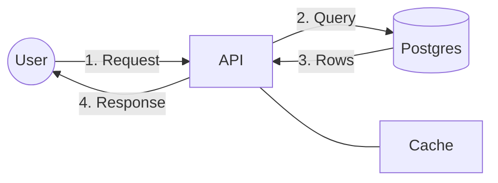

# Interactive Architecture Diagram Visualizer

An interactive visualization tool for exploring and understanding system architecture diagrams through dynamic sequences and component interactions.

## Overview

This project provides an interactive way to visualize and explore system architecture diagrams. It uses p5.js for rendering and allows users to step through system interactions, making it an excellent tool for understanding complex system designs and architectural patterns.

## Features

- Interactive sequence visualization
- Step-by-step walkthrough of system interactions
- Multiple sequence navigation
- Message schema visualization
- Component interaction exploration
- PlantUML parsing support
- Visual feedback system

## Mermaid Flow Animator (`/flow`)

`flow/index.html` is a standalone web viewer that takes a Mermaid flowchart and plays it as an animated flow. Numbered edge labels become steps that draw in one at a time, while unnumbered edges stay visible as the static architecture.

- Label prefixes `1.`, `2)`, `3:`, `1.2` and `2a.` all work; edges that share a number play in parallel.
- `%% <n>: text` comments add narration for step `n`.
- Controls: play/pause, step forward/back, jump to any step, speed, loop. Keys: <kbd>Space</kbd>, <kbd>←</kbd>/<kbd>→</kbd>, <kbd>Home</kbd>, <kbd>F</kbd> (hide editor).
- **Copy link** puts the source in the URL hash so a diagram can be shared.
- Uses Mermaid's own layout, so subgraphs, shapes and `classDef` styling carry over. Only `flowchart`/`graph` diagrams animate; other diagram types render as a still.

Open `flow/index.html` directly, or `/flow/` on the deployed site.

## Usage

### Navigation Controls

- **Shift + Spacebar**: Toggle pause/play animation
- **Shift + S**: Toggle message schemas between components
- **Shift + R**: Reset current message
- **Shift + L**: Reload PlantUML text
- **Shift + D**: Toggle debug mode
- **Arrow Keys**: Navigate between different sequences

### PlantUML Text Editor

The visualization includes a PlantUML text editor on the right side of the screen. You can:
- Edit the PlantUML text directly in the editor
- Click the "Reload PlantUML text" button or press **Shift + L** to parse and visualize your changes
- The editor supports standard PlantUML sequence diagram syntax

## Setup

1. Clone this repository
2. Open `index.html` in a modern web browser
3. The visualization will start automatically

## Technical Stack

- p5.js for visualization
- HTML5 & CSS3
- JavaScript for interaction handling

## Notes

This tool is designed to help with:
- System Design exploration
- Visual System Specification and Verification
- Understanding complex system interactions
- Interactive learning of architectural patterns

## Future Enhancements

- Click-through component exploration
- Deterministic choice operators
- Dynamic element creation and destruction
- Automatic layout with drag-and-drop state preservation
- Compare mode for interaction verification
- State management improvements

